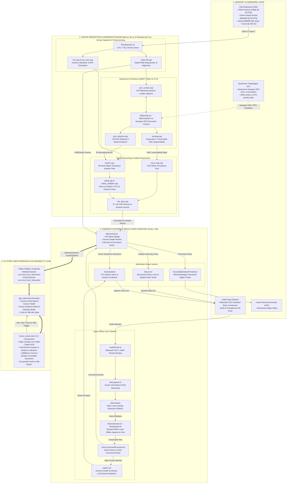

# HearSight + Argus System Architecture & Workflow

## Overview
**HearSight + Argus** is an offline assistive navigation and voice assistant system designed for blind and visually impaired individuals. It integrates **Intel RealSense D455 3D perception**, **Qualcomm Hexagon NPU AI acceleration (QNN / QAIRT)**, **Argus offline speech processing**, and an **accessible Flutter mobile interface**.

---

## 1. End-to-End Architecture Diagram

---

## 2. Core Subsystems

### A. Sensory Ingestion & Perception (C++ Native)
- **Library Target**: `libhsv2_lite.so` & `librealsense2.so`
- **Source Files**: `native-lib.cpp`, `imu.cpp`, `tracker.cpp`, `safety.cpp`, `nav_plan.cpp`, `local_map.cpp`
- **Key Functions**:
  - Ingests synchronized RGB (1080p) + Depth (848x480) streams from Intel RealSense D455.
  - Aligns depth to color coordinates and deprojects metric 3D point clouds.
  - Calibrates vertical orientation using the camera's internal Bosch BMI085 IMU.
  - Tracks obstacles across consecutive frames using Kalman filters.
  - Computes Time-to-Collision (TTC) and enforces safety zones (Clear, Caution, Danger).
  - Dynamically computes local path deviations and detour vectors with D* Lite.

### B. Qualcomm AI Runtime (QNN / QAIRT v2.47.0)
- **Source Files**: `qnn_runtime.cpp`, `yolo_detector.cpp`, `semseg.cpp`
- **Hardware Acceleration**: Executes deep neural networks on Qualcomm Hexagon NPU (HTP backends v73, v75, v81) via dynamic runtime linking (`libQnnHtp.so`).
- **Models**:
  - **YOLOv8**: Real-time object detection (pedestrians, vehicles, obstacles, doors, stairs).
  - **DeepLabv3+**: Semantic scene segmentation (sidewalk, roadway, terrain traversability).

### C. Argus Offline Speech & Voice Engine (Kotlin)
- **Package**: `com.hsv2.hsv2_lite.voice`
- **Source Files**: `AudioRoute.kt`, `MicCapture.kt`, `SileroVad.kt`, `MoonshineAsr.kt`, `ParakeetAsr.kt`, `VoiceCommandProcessor.kt`, `Earcon.kt`, `VoiceAssistantManager.kt`
- **Key Functions**:
  - Automatically negotiates audio endpoints (Bluetooth SCO headsets, smart glasses, internal microphone).
  - Continuously samples 16 kHz 16-bit mono PCM audio.
  - Applies Silero VAD to detect user speech frames and discard background noise.
  - Transcribes speech entirely on-device via Sherpa-ONNX (Moonshine/Parakeet models) without internet dependency.
  - Parses voice intents (`"What's in front of me?"`, `"Stop"`, `"Where am I?"`, `"Battery status"`).
  - Delivers spatial audio earcons and synthesized voice guidance.

### D. User Interface & State Management (Flutter / Dart)
- **Package**: `lib/` (`main.dart`, `screens/home_screen.dart`, `providers/app_state.dart`)
- **Key Functions**:
  - High-contrast visual interface for low-vision users.
  - TalkBack screen-reader labeling on all interactive elements.
  - Real-time HUD showing camera status, active obstacle distance, directional arrows, and push-to-talk mic button.
  - Communicates with native layer via asynchronous `MethodChannel` and streaming `EventChannel`.
