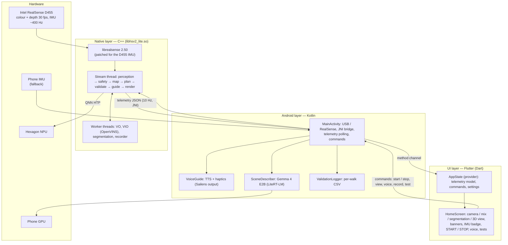
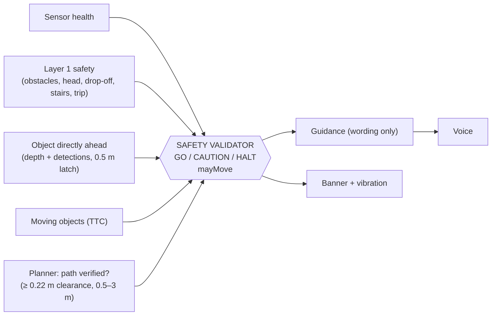
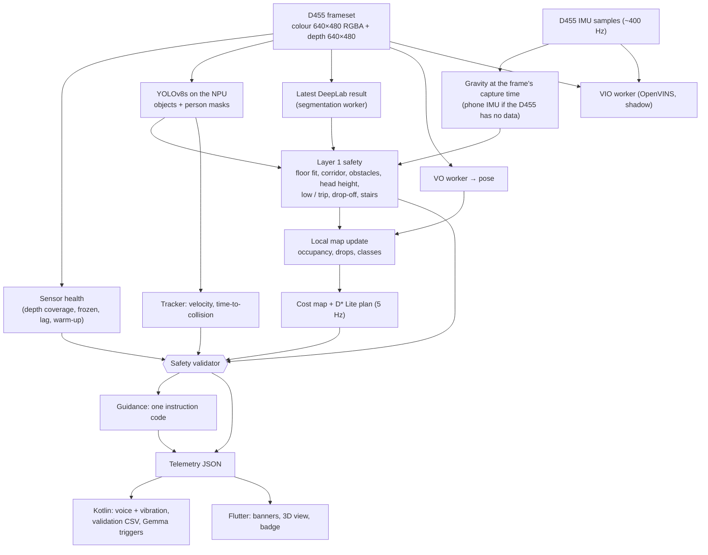
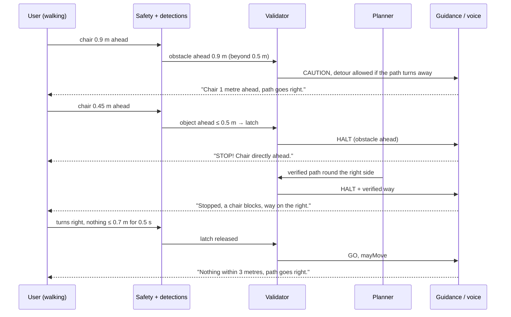
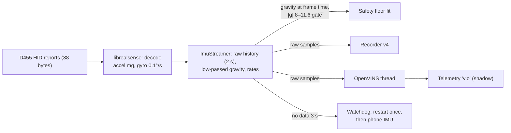

# HearSight — Project Documentation

HearSight is a head-worn navigation assistant for blind and low-vision people. An Intel
RealSense D455 depth camera and an Android phone are worn together; the phone sees the space
ahead, builds a local 3D map, plans a safe path and speaks one clear instruction at a time
("Chair 2 metres ahead, path goes right."), in English or Tamil, with vibration cues. All
processing runs on the phone — no cloud, no network.

*State: 22 Oct 2026, `main`.* Repository build / run / debug: [README](../README.md).

## Contents

- [01 — Overview](#01--overview)
- [02 — Architecture](#02--architecture)
- [03 — Flow](#03--flow)
- [04 — Tech stack](#04--tech-stack)
- [05 — Benchmark](#05--benchmark)

---

## 01 — Overview

### The problem

A white cane finds what is on the ground within reach; a guide dog avoids obstacles but does
not explain the scene. Neither warns about head-height obstacles, drop-offs a step away, or a
person walking straight at you — and neither tells you *which way* is free. HearSight adds that
information as short spoken instructions, without replacing the cane.

### Who it is for

Blind and low-vision people walking indoors (corridors, halls, offices, homes). Outdoor use is
planned (Phase 8). The user wears a head mount with the camera and phone; no screen interaction
is needed while walking (large START / STOP, TalkBack labels, spoken start / stop).

### What it does

| Capability | Behaviour |
|---|---|
| **Stop in time** | Anything directly ahead within **0.5 m** → "STOP! Chair directly ahead." — then a way round it: "Stopped, a chair blocks, way on the left." |
| **Find the way** | Plans a safe path 2.5–5 m ahead (incremental D\* Lite), kept away from walls, passable through doorways, re-planned as people move; the way round an obstacle keeps its side |
| **Hazards** | Head-height obstacles, low objects, trip hazards (3–10 cm), drop-offs, steps and stairs; drops judged against the floor tracked step by step (glossy floors and mirror images do not trigger) |
| **Moving objects** | People and vehicles tracked with velocity and time-to-collision |
| **Situation sentences** | Object + distance + direction, the same on screen and in the voice: "Person 2 metres ahead, path goes left.", "Nothing within 3 metres.", "Door 3 metres ahead" |
| **Languages and feedback** | English, Tamil or both (each in its own voice); urgent messages interrupt; vibration patterns for STOP, left / right, camera lost; works in silent mode |
| **Scene description (optional)** | On-phone Gemma 4 E2B: "What's ahead?" on request and short ✨ Live comments on events; filtered so it can never contradict the safety decision |
| **Sensor health** | Camera covered / frozen / lagging / unplugged → "STOP! Camera …"; 1 s start-up warm-up ("Wait, checking the way") |
| **3D view** | Live 3D map with class colours and a top-down navigation inset for a sighted helper; path green when verified, dashed amber while waiting |

### Hardware

| Part | Used |
|---|---|
| Depth camera | Intel RealSense **D455**: colour 640×480 + depth 640×480 at 30 fps, IMU (gyro + accel) ~400 Hz, over USB-C |
| Phone | OnePlus **CPH2745** (Snapdragon **SM8850**, Hexagon **v81** NPU) — main target; CPH2729 (SM6650, v73) also supported |
| Android | 12+ (minSdk 31), tested on Android 16 |
| Mount | Head mount holding camera and phone, camera level |

### Design principles

1. **Safety first, one authority** — a single safety validator decides GO / CAUTION / STOP every
   frame; guidance, banner, voice and vibration only word that decision, so they never disagree.
2. **On-device** — every model runs on the phone (NPU / GPU); works offline; no images leave the phone.
3. **One clear instruction at a time** — situation sentences, no chatter, urgent messages first.
4. **Measured, not guessed** — synthetic tests, random stress tests, recorded walks replayed on the
   PC, and a scored field protocol (Phase 7).

### Status (22 Oct 2026)

| Area | State |
|---|---|
| Perception on the NPU, safety layer, 3D map, D\* Lite planner, guidance, voice (EN / TA), vibration | Done |
| Scene description (Gemma), sensor health, validation test mode, walk recorder + PC replay | Done |
| D455 IMU (gravity for floor / drop-off checks, ~1 ms frame sync, watchdog with phone fallback) | Done |
| Visual-inertial odometry (OpenVINS) | In progress — runs on the phone in shadow mode; tuning needs recorded walks |
| Phase 7 field validation (9 scenarios × 3 walks) | Pending — needs a rigid, level mount |
| Outdoor use (Phase 8), user pilot | Planned |

### Known limitations

- Camera mount tilt (~12–25°) causes some false STOP / drop-off warnings.
- The D455 has no factory IMU calibration; the floor fine alignment corrects it once it locks.
- Distances are the app's own depth measurements, not tape-measured ground truth.
- Indoor-tuned; outdoor is not done.
- OpenVINS is GPL-3.0: distributing the app means publishing its source under GPL-3.0.

---

## 02 — Architecture

### Layers

HearSight is one Android app with three layers:

### Native modules (`android/app/src/main/cpp`)

| Module | Responsibility |
|---|---|
| `native-lib.cpp` | Stream thread: wires every stage, telemetry JSON, JNI entry points, recovery (stall / depth / IMU) |
| `qnn_runtime.*` | Qualcomm QNN HTP runtime: loads the context binaries, runs graphs on the NPU |
| `yolo_detector.*` | YOLOv8s / YOLOv8s-seg detection (80 COCO classes, person masks) |
| `semseg.*` | DeepLabV3+ ADE20K segmentation on its own thread; 150 classes → navigation classes (`nav_classes.h`) |
| `safety.*` | Layer 1 safety: floor fit (with gravity), walking corridor, obstacles, head height, low objects, trip hazards, drop-offs (tracked floor), stairs |
| `tracker.*` | Moving objects: velocity, time-to-collision, ego-motion compensation |
| `imu.*` | D455 IMU: samples, frame-time gravity, raw history, IMU → depth rotation |
| `imu_sync.*`, `gravity_calib.*` | Phone IMU at frame time; phone → camera rotation and D455 fine alignment from the floor |
| `vo.*`, `rigid.*` | Visual odometry (KLT features + depth, RANSAC rigid motion) on its own thread |
| `vio_thread.*`, `vio_calib.h` | OpenVINS visual-inertial odometry on its own thread (shadow mode) |
| `local_map.*` | 16 × 16 m local map, 10 cm cells: occupancy, drop-offs, classes, ray clearing |
| `nav_plan.*` | Cost map + incremental D\* Lite planner, string pulling, smoothing, clearances |
| `sensor_health.*` | Camera trust: blocked, frozen, lag, frame gaps, slow model, start-up warm-up |
| `safety_validator.*` | **The single safety authority**: GO / CAUTION / HALT, `mayMove`, alert |
| `guidance.*` | Turns verdict + path into one instruction code with hysteresis |
| `view3d.*` | CPU 3D view + top-down navigation inset |
| `recorder.*` | Walk recording (.hsr v4) for offline replay |
| `librealsense/` | Intel RealSense SDK 2.50, built from source; patched HID code for the D455 IMU |

### Kotlin modules (`android/app/src/main/kotlin`)

| Module | Responsibility |
|---|---|
| `MainActivity.kt` | USB permission / attach / detach, JNI bridge, telemetry polling, Flutter method channel, Gemma triggers and safety filter |
| `VoiceGuide.kt` | Voice + haptic policy: priorities, cooldowns, repeats, situation sentences (EN / TA) |
| `SceneDescriber.kt` | Gemma 4 E2B via LiteRT-LM on the GPU |
| `PhoneImu.kt` | Phone gyro / accelerometer |
| `ValidationLogger.kt` | Phase 7 per-walk CSV (10 rows / s + every spoken message) |
| `com.sailens.output` | Speech manager, haptics, accessibility status (Apache-2.0, from Sailens) |

### Flutter modules (`lib/`)

| Module | Responsibility |
|---|---|
| `providers/app_state.dart` | Telemetry parsing, commands, voice / language / test settings |
| `screens/home_screen.dart` | Views, banners, legend, IMU badge, controls, test list |
| `models/models.dart` | Telemetry model (alerts, plan, IMU, VIO, …) |

### Threads

| Thread | Work | Rate |
|---|---|---|
| Stream thread (native) | Frames, YOLO, safety, tracking, map, plan, validator, guidance, telemetry, render | 30 fps (planner 5 Hz, 3D view 15 Hz) |
| Segmentation worker | DeepLab on the NPU, latest frame only | As fast as the NPU allows |
| VO worker | Visual odometry, latest frame only | ≤ 30 fps |
| VIO worker (OpenVINS) | IMU + grey frame → pose; drops frames while busy | ≤ 30 fps |
| librealsense callbacks | Frames, D455 IMU samples (~400 Hz each) | Device rate |
| Recorder writer | Writes .hsr frames + colour snapshots; drops if the disk lags | 30 fps |
| Android main / TTS | Telemetry polling (10 Hz), voice, haptics, Gemma requests | 10 Hz |
| Gemma (LiteRT-LM) | One description at a time | ~1.1 s per answer |

Workers never block the stream thread: they take the newest frame and drop the rest, so STOP
and guidance are never delayed by a slow model.

### The safety authority

Verdict order, most severe first: sensor fault → object ahead within 0.5 m → Layer 1 STOP →
moving-object STOP → CAUTION reasons. Walking advice (`mayMove`) only when nothing halts, sensors
are fully OK, no stairs, and the path is verified. Gemma's text passes a filter that removes
"go / move forward / clear" claims whenever `mayMove` is false.

### Data contracts

- **Telemetry JSON** (native → Kotlin → Flutter, 10 Hz): status, fps, alert + reason + distance,
  validator verdict, guide code + text + situation sentence, detections, plan (ok, turn,
  clearance), health, `imu` (source, rates, pitch / roll, age, alignment), `vio` (running, init,
  position, ms), recorder state.
- **Commands** (Flutter → Kotlin → native): start / stop, view mode, voice language, record start /
  stop, test scenario, "What's ahead?", ✨ Live on / off.
- **Recording .hsr v4**: header (intrinsics, depth → colour) + per frame: half-res grey, depth (½),
  VO result, phone IMU, segmentation, raw D455 IMU samples.

---

## 03 — Flow

### 1. Per frame (stream thread, 30 fps)

### 2. Start-up

1. User taps **START** (or the spoken start command); Kotlin asks for USB permission if needed.
2. Native: pipeline starts colour + depth at 30 fps (`debug.hsv2.fps` to change) and the D455 IMU
   at its highest rate; models are already loaded on the NPU.
3. **Warm-up (1 s, up to 3 s while depth is sparse):** sensor health reports *warmup* → "Wait,
   checking the way", no movement advice, no STOP alarm; the 0.5 m latch is not set.
4. Floor fit, IMU gravity and map settle; the planner gets its first path.
5. VIO (if `debug.hsv2.vio 1`) starts its thread and initialises once the user stands still and
   then moves.

### 3. Object ahead → STOP → re-route

The planner keeps its target through short "blocked" moments (~2 s), so the way round keeps its
side; if that side really closes, it switches.

### 4. Voice and vibration

1. Telemetry arrives every 100 ms; `VoiceGuide` reads the guide code, object ahead (class,
   distance) and the validator verdict.
2. **Situation sentence** built from code + object + distance + direction (English and Tamil).
3. **Priorities:** camera fault 100 › object ahead 95 › stop 90 › stairs 85 › no clear way 70 ›
   turns 60 › door 45 › bear 40 › straight 30 › wait 20. A strictly higher priority interrupts speech.
4. **Cooldowns and repeats:** the same instruction is not repeated within its cooldown; STOP-type
   messages repeat every 3–5 s while they last; a closer object or a new object is spoken again.
5. **Vibration** follows the same alert (STOP pattern, left / right, camera lost).
6. **Gemma (✨ Live):** on events (stopped > 2 s, door / stairs / turn, new object 0.5–3 m, open
   walking every 15 s) the latest colour frame + sensor facts go to Gemma; the answer is filtered
   (no "go / move forward" while walking is not allowed) and spoken after the instruction, at the
   lowest priority, dropped if older than ~3 s.

### 5. IMU and VIO

### 6. Recording and offline replay

1. **Record** (button): the recorder writes `walk_<date>.hsr` on the phone — grey, depth,
   phone VO and IMU, segmentation, raw D455 IMU — plus colour snapshots (2 Hz).
2. Copy to the PC (`adb pull`).
3. Replay the same stages on the PC:
   - `native_tests/replay_map` — safety, map, planner, 3D snapshots (old vs new code side by side);
   - `native_tests/replay_vo` — visual odometry;
   - `tools/vio/replay_vio` — OpenVINS on the walk vs the phone's VO;
   - `tools/vlm/describe_test.py` — scene-description models on the snapshots.
4. Fixes are measured on the same walks before going back to the phone.

### 7. Validation walk (Phase 7)

Tap ✓ → pick a scenario (S1 wall … S9 chair) → walk → tap the amber banner → a CSV per walk on
the phone → `tools/validate_walks.py --pull` scores PASS / FAIL per check
([protocol](phase7-validation.md)).

---

## 04 — Tech stack

### Languages and frameworks

| Layer | Technology | Version |
|---|---|---|
| UI | **Flutter** / Dart, `provider` state management, `http` | Flutter 3.47.3, Dart SDK ^3.12.2, provider ^6.1.5, http ^1.6.0 |
| Android | **Kotlin**, kotlinx-coroutines | coroutines 1.9.0; minSdk 31, tested on Android 16 |
| Native | **C++17** via JNI, CMake | Android NDK 28.2.13676358 (clang), CMake 3.22 |
| Build | Gradle (Kotlin DSL), Flutter tool | `flutter build apk --release --target-platform android-arm64` |

### Native libraries

| Library | Use | Version | Licence |
|---|---|---|---|
| **Intel RealSense SDK (librealsense)** | D455 colour, depth, IMU over USB (built from source, rsusb backend) | 2.50.0, patched HID for the D455 IMU | Apache-2.0 |
| **Qualcomm QNN / QAIRT** (HTP backend) | Runs the AI models on the Hexagon NPU | 2.47.0 | Qualcomm licence (not in git) |
| **OpenVINS** (ov_core, ov_init static, ov_msckf) | Visual-inertial odometry (MSCKF) | upstream master, 2025-11 | **GPL-3.0** |
| **OpenCV** (Android SDK, static) | Image ops for OpenVINS (KLT, features) | 4.x Android SDK | Apache-2.0 |
| **Eigen** | Linear algebra (OpenVINS) | 3.4 | MPL-2.0 |
| **Boost** (headers only) | posix_time, chi-squared (OpenVINS); `boost::filesystem` mapped to `std::filesystem` | 1.7x headers | BSL-1.0 |
| HearSight native code | Safety, map, planner (D\* Lite), VO, tracker, validator, guidance, 3D view, recorder | — | project |

### Android libraries

| Library | Use | Licence |
|---|---|---|
| **LiteRT-LM** (`com.google.ai.edge.litertlm:litertlm-android:0.18.0`) | Runs Gemma on the phone GPU | Apache-2.0 |
| **Sailens Android** output components | SpeechManager, Announcement, HapticPlayer, accessibility status | Apache-2.0 (copied, see `third_party/sailens/`) |
| Android TextToSpeech | English and Tamil voices | Android |

### AI models

| Model | Task | Format / precision | Input → output | Size | Runs on |
|---|---|---|---|---|---|
| **YOLOv8s** (Ultralytics) | Object detection, 80 COCO classes | QNN context binary, INT8 (v81 + v73) | 640×640 RGB → 80 × 8400 scores + boxes | 12 MB | NPU |
| **YOLOv8s-seg** | Detection + person masks | QNN, INT8 | 640×640 → boxes, scores, 32 mask coefficients, 160×160×32 protos | 12 MB | NPU |
| **DeepLabV3+ MobileNetV2** (MMSegmentation, ADE20K) | Scene segmentation, 150 classes → navigation classes | QNN, INT8 | 288×384 RGB → 72×96 class map | 16 MB | NPU |
| **Gemma 4 E2B-it** (Google) | Scene description ("What's ahead?", ✨ Live) | `.litertlm` | colour frame + sensor facts → one sentence | 2.6 GB (on the phone, not in git) | GPU |

Model files for the NPU are stored in Git LFS (`android/app/src/main/assets/qnn/`). Conversion
steps: [tools/deeplab](../tools/deeplab/README.md). Licences: YOLOv8 AGPL-3.0, DeepLab /
ADE20K own terms, Gemma terms of use — check before distribution.

### Algorithms (own implementation)

| Area | Method |
|---|---|
| Floor and safety | Gravity-aided floor plane fit, walking-corridor bins, drop-offs vs the locally tracked floor, reflection rejection with segmentation |
| Visual odometry | KLT feature tracking on half-res grey + depth back-projection, RANSAC rigid motion, plausibility gate (≤ 3 m/s, ≤ 6 rad/s) |
| Local map | 2.5D log-odds occupancy, 10 cm cells, 16 × 16 m, ray clearing, class histograms, recentring |
| Planning | Cost map (inflation, wall preference, unknown cost) + **incremental D\* Lite** with a virtual goal over 2.5–5 m candidates, goal memory, string pulling, Chaikin smoothing |
| Tracking | Moving-object velocity and time-to-collision with ego-motion compensation |
| Calibration | Horn's method for phone → camera and D455 → floor rotation from gravity pairs |

### Tools and tests

| Tool | Purpose |
|---|---|
| `native_tests/run_tests.sh` | 12 PC test groups (safety, walk, semantic, gravity, VO, map, trip, plan, recorder, guidance, health, validator, tracker) |
| `native_tests/replay_map`, `replay_vo` | Replay recorded walks through safety, map, planner, VO |
| `tools/vio/replay_vio` | OpenVINS replay of v4 recordings (PC build without ROS) |
| `tools/validate_walks.py` | Phase 7 walk scorer |
| `tools/deeplab/` | DeepLab → QNN conversion |
| `tools/vlm/describe_test.py` | Scene-description model tests (PC) |
| QAIRT `qnn-net-run`, `qnn-profile-viewer` | NPU benchmarks |
| `adb` (USB / wireless debugging) | Install, logs, recordings |

### Hardware stack

Intel RealSense D455 → USB-C → OnePlus CPH2745 (Snapdragon SM8850, Hexagon v81 NPU; GPU for
Gemma), head mount. Second supported phone: CPH2729 (SM6650, Hexagon v73).

---

## 05 — Benchmark

All phone numbers are from the **OnePlus CPH2745 (Snapdragon SM8850, Hexagon v81)** unless noted.

### 1. AI models on the NPU (measured 22 Oct 2026)

| Model | Input | Size | Load | **NPU time / frame** | Call incl. transfer | Throughput* |
|---|---|---|---|---|---|---|
| YOLOv8s INT8 | 640×640 | 12 MB | 29 ms | **3.0 ms** | 3.9 ms | — |
| YOLOv8s-seg INT8 | 640×640 | 12 MB | 32 ms | **4.3 ms** | 5.4 ms | — |
| DeepLabV3+ INT8 (ADE20K) | 288×384 | 16 MB | 29 ms | **12.9 ms** | 14.3 ms | 61 inf/s |

\*Throughput as reported by `qnn-net-run` including writing every output to storage; the YOLO
runs wrote large outputs (≈ 0.7–1.5 MB each), so their figure (7–17 inf/s) measures storage,
not the NPU, and is left out.

**Method:** QAIRT 2.47 `qnn-net-run` on the phone, the app's own context binaries, 100 runs per
model with 8-bit test input, `--profiling_level basic`, default NPU power mode (as the app uses),
8 HVX threads; averages from `qnn-profile-viewer`.

**Reading:** YOLO + DeepLab together use about **16 ms of NPU time per frame**, inside the 33 ms
budget at 30 fps; DeepLab runs on its own worker thread. The app's own log showed 7–17 ms
inference per frame, consistent with these numbers plus pre- / post-processing.

### 2. On-phone language model

| Model | Runtime | Size | First answer | **Later answers** |
|---|---|---|---|---|
| Gemma 4 E2B-it | LiteRT-LM, GPU | 2.6 GB | 7.8 s (warm-up) | **1.03–1.27 s, avg ≈ 1.12 s** (9 answers) |

**Method:** the app's scene-description test (10 recorded snapshots, `scene_test.csv`, 22 Oct).
Live narration in the phone log the same day: 1.0–1.2 s per comment.

### 3. Pipeline (CPU)

| Stage | Number | Source |
|---|---|---|
| Whole pipeline | **~30 fps**, camera-to-screen **35–50 ms** | Phone (README key numbers) |
| Per-frame processing p99 | ~24 ms (33 ms budget) | Phone timing logs |
| Local map update | 2–4 ms / frame | Phone |
| **D\* Lite planner** | **avg 0.4–2.3 ms**, worst ~15 ms (full re-search), at 5 Hz | PC replay of 3 recorded walks |
| Planner vs old Dijkstra | same paths (hall walk 79 / 135 ok, both), avg 2.3 vs 3.0 ms and 0.4 vs 1.8 ms | PC replay |
| D455 IMU | gyro ~399 Hz, accel ~404 Hz; frame match 0.0–1.3 ms; newest sample 0–3 ms old | Phone log |
| 3D view | redrawn at 15 Hz | Phone |
| Telemetry to UI | 10 Hz | Phone |

### 4. Quality and safety checks

| Check | Result |
|---|---|
| PC test groups | 12 groups, 0 failures (`native_tests/run_tests.sh`) |
| Safety invariant | 100,000 random frames: no walking advice without the validator's permission |
| Glossy-floor fix on recordings | false drop-off STOP frames 6 → 0 (Oct 18 walk), drop sightings 34 → 24 (hall) |
| Start-up warm-up | first-frame false "STOP 0.33 m" (11 % depth) → "Wait, checking the way" |
| Side keeping | blocked-plan-in-between test: old planner moved goal 1.9 m and flipped side; new keeps both |
| D455 IMU decode | level camera P −0.0°, R −1.2°; \|a\| 9.72–9.78 m/s²; steady frames 0 → 56–163 per 10 s |

### 5. Not measured yet

| Item | Needed |
|---|---|
| YOLO accuracy (mAP) of the INT8 phone model | COCO validation set (download) |
| DeepLab accuracy (mIoU) of the INT8 model | `tools/deeplab/scripts/eval.py` on ADE20K images |
| v73 models (CPH2729 / SM6650) | That phone connected |
| OpenVINS VIO: time per frame, CPU load, drift vs VO | A v4 recorded walk + a phone run with `debug.hsv2.vio 1` |
| Battery and temperature over a 30 min walk | Sustained test (the September test files are empty) |
| Distances vs tape-measured ground truth | Phase 7 walks with floor marks |
