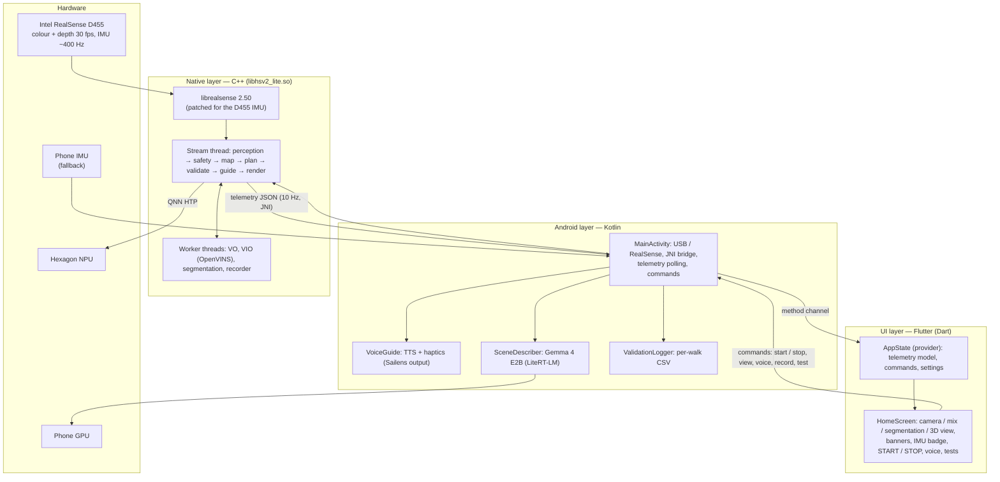
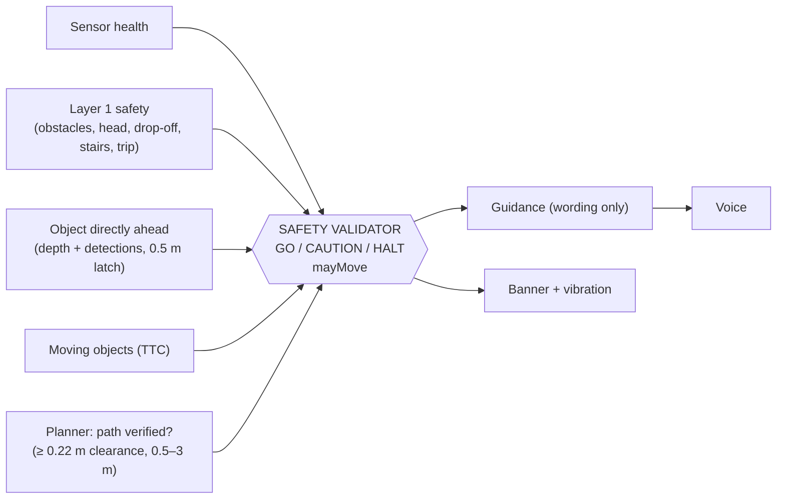

# 02 — Architecture

## Layers

HearSight is one Android app with three layers:

## Native modules (`android/app/src/main/cpp`)

| Module | Responsibility |
|---|---|
| `native-lib.cpp` | Stream thread: wires every stage, telemetry JSON, JNI entry points, recovery (stall / depth / IMU) |
| `qnn_runtime.*` | Qualcomm QNN HTP runtime: loads the context binaries, runs graphs on the NPU |
| `yolo_detector.*` | YOLOv8s / YOLOv8s-seg detection (80 COCO classes, person masks) |
| `semseg.*` | DeepLabV3+ ADE20K segmentation on its own thread; 150 classes → navigation classes (`nav_classes.h`) |
| `safety.*` | Layer 1 safety: floor fit (with gravity), walking corridor, obstacles, head height, low objects, trip hazards, drop-offs (tracked floor), stairs |
| `tracker.*` | Moving objects: velocity, time-to-collision, ego-motion compensation |
| `imu.*` | D455 IMU: samples, frame-time gravity, raw history, IMU → depth rotation |
| `imu_sync.*`, `gravity_calib.*` | Phone IMU at frame time; phone → camera rotation and D455 fine alignment from the floor |
| `vo.*`, `rigid.*` | Visual odometry (KLT features + depth, RANSAC rigid motion) on its own thread |
| `vio_thread.*`, `vio_calib.h` | OpenVINS visual-inertial odometry on its own thread (shadow mode) |
| `local_map.*` | 16 × 16 m local map, 10 cm cells: occupancy, drop-offs, classes, ray clearing |
| `nav_plan.*` | Cost map + incremental D\* Lite planner, string pulling, smoothing, clearances |
| `sensor_health.*` | Camera trust: blocked, frozen, lag, frame gaps, slow model, start-up warm-up |
| `safety_validator.*` | **The single safety authority**: GO / CAUTION / HALT, `mayMove`, alert |
| `guidance.*` | Turns verdict + path into one instruction code with hysteresis |
| `view3d.*` | CPU 3D view + top-down navigation inset |
| `recorder.*` | Walk recording (.hsr v4) for offline replay |
| `librealsense/` | Intel RealSense SDK 2.50, built from source; patched HID code for the D455 IMU |

## Kotlin modules (`android/app/src/main/kotlin`)

| Module | Responsibility |
|---|---|
| `MainActivity.kt` | USB permission / attach / detach, JNI bridge, telemetry polling, Flutter method channel, Gemma triggers and safety filter |
| `VoiceGuide.kt` | Voice + haptic policy: priorities, cooldowns, repeats, situation sentences (EN / TA) |
| `SceneDescriber.kt` | Gemma 4 E2B via LiteRT-LM on the GPU |
| `PhoneImu.kt` | Phone gyro / accelerometer |
| `ValidationLogger.kt` | Phase 7 per-walk CSV (10 rows / s + every spoken message) |
| `com.sailens.output` | Speech manager, haptics, accessibility status (Apache-2.0, from Sailens) |

## Flutter modules (`lib/`)

| Module | Responsibility |
|---|---|
| `providers/app_state.dart` | Telemetry parsing, commands, voice / language / test settings |
| `screens/home_screen.dart` | Views, banners, legend, IMU badge, controls, test list |
| `models/models.dart` | Telemetry model (alerts, plan, IMU, VIO, …) |

## Threads

| Thread | Work | Rate |
|---|---|---|
| Stream thread (native) | Frames, YOLO, safety, tracking, map, plan, validator, guidance, telemetry, render | 30 fps (planner 5 Hz, 3D view 15 Hz) |
| Segmentation worker | DeepLab on the NPU, latest frame only | As fast as the NPU allows |
| VO worker | Visual odometry, latest frame only | ≤ 30 fps |
| VIO worker (OpenVINS) | IMU + grey frame → pose; drops frames while busy | ≤ 30 fps |
| librealsense callbacks | Frames, D455 IMU samples (~400 Hz each) | Device rate |
| Recorder writer | Writes .hsr frames + colour snapshots; drops if the disk lags | 30 fps |
| Android main / TTS | Telemetry polling (10 Hz), voice, haptics, Gemma requests | 10 Hz |
| Gemma (LiteRT-LM) | One description at a time | ~1.1 s per answer |

Workers never block the stream thread: they take the newest frame and drop the rest, so STOP
and guidance are never delayed by a slow model.

## The safety authority

Verdict order, most severe first: sensor fault → object ahead within 0.5 m → Layer 1 STOP →
moving-object STOP → CAUTION reasons. Walking advice (`mayMove`) only when nothing halts, sensors
are fully OK, no stairs, and the path is verified. Gemma's text passes a filter that removes
"go / move forward / clear" claims whenever `mayMove` is false.

## Data contracts

- **Telemetry JSON** (native → Kotlin → Flutter, 10 Hz): status, fps, alert + reason + distance,
  validator verdict, guide code + text + situation sentence, detections, plan (ok, turn,
  clearance), health, `imu` (source, rates, pitch / roll, age, alignment), `vio` (running, init,
  position, ms), recorder state.
- **Commands** (Flutter → Kotlin → native): start / stop, view mode, voice language, record start /
  stop, test scenario, "What's ahead?", ✨ Live on / off.
- **Recording .hsr v4**: header (intrinsics, depth → colour) + per frame: half-res grey, depth (½),
  VO result, phone IMU, segmentation, raw D455 IMU samples.
