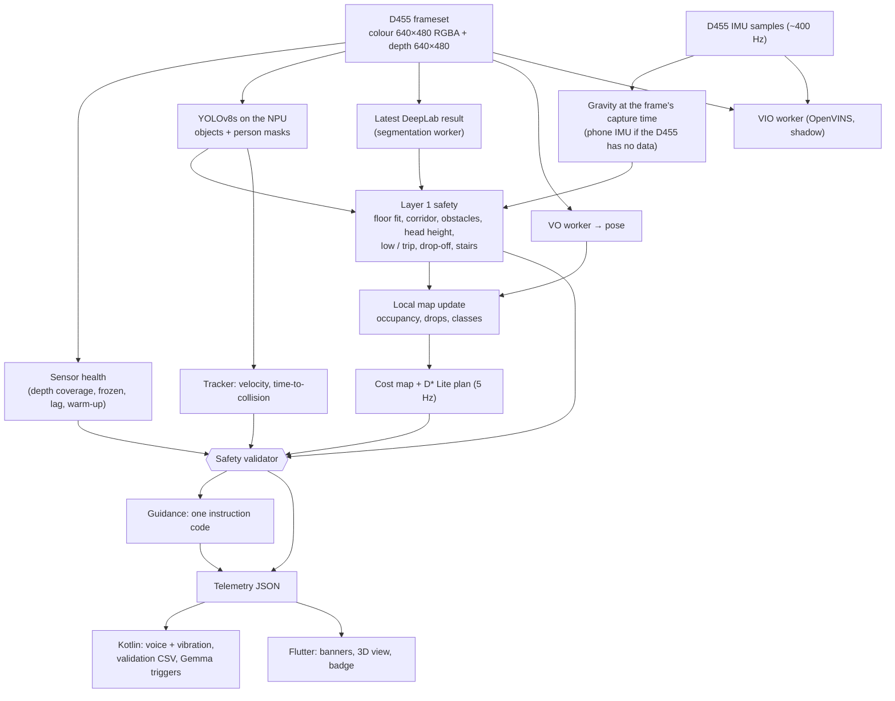
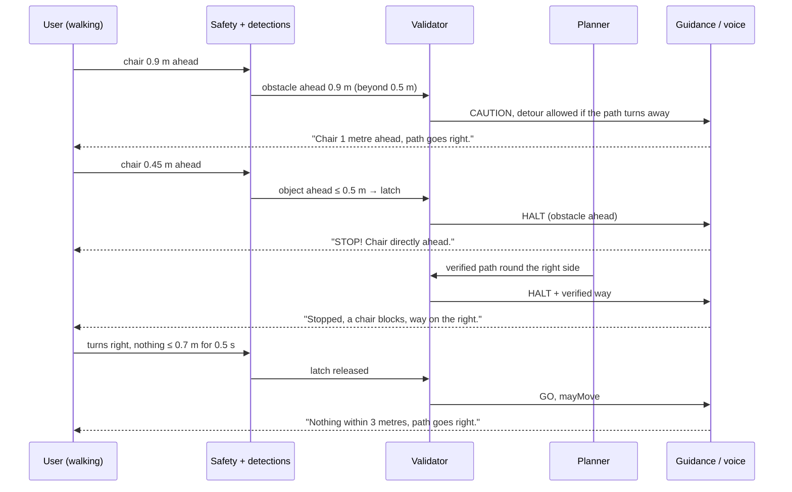
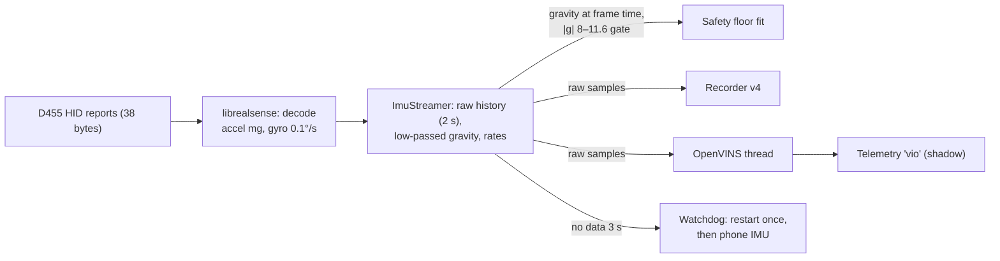

# 03 — Flow

## 1. Per frame (stream thread, 30 fps)

## 2. Start-up

1. User taps **START** (or the spoken start command); Kotlin asks for USB permission if needed.
2. Native: pipeline starts colour + depth at 30 fps (`debug.hsv2.fps` to change) and the D455 IMU
   at its highest rate; models are already loaded on the NPU.
3. **Warm-up (1 s, up to 3 s while depth is sparse):** sensor health reports *warmup* → "Wait,
   checking the way", no movement advice, no STOP alarm; the 0.5 m latch is not set.
4. Floor fit, IMU gravity and map settle; the planner gets its first path.
5. VIO (if `debug.hsv2.vio 1`) starts its thread and initialises once the user stands still and
   then moves.

## 3. Object ahead → STOP → re-route

The planner keeps its target through short "blocked" moments (~2 s), so the way round keeps its
side; if that side really closes, it switches.

## 4. Voice and vibration

1. Telemetry arrives every 100 ms; `VoiceGuide` reads the guide code, object ahead (class,
   distance) and the validator verdict.
2. **Situation sentence** built from code + object + distance + direction (English and Tamil).
3. **Priorities:** camera fault 100 › object ahead 95 › stop 90 › stairs 85 › no clear way 70 ›
   turns 60 › door 45 › bear 40 › straight 30 › wait 20. A strictly higher priority interrupts speech.
4. **Cooldowns and repeats:** the same instruction is not repeated within its cooldown; STOP-type
   messages repeat every 3–5 s while they last; a closer object or a new object is spoken again.
5. **Vibration** follows the same alert (STOP pattern, left / right, camera lost).
6. **Gemma (✨ Live):** on events (stopped > 2 s, door / stairs / turn, new object 0.5–3 m, open
   walking every 15 s) the latest colour frame + sensor facts go to Gemma; the answer is filtered
   (no "go / move forward" while walking is not allowed) and spoken after the instruction, at the
   lowest priority, dropped if older than ~3 s.

## 5. IMU and VIO

## 6. Recording and offline replay

1. **Record** (button): the recorder writes `walk_<date>.hsr` on the phone — grey, depth,
   phone VO and IMU, segmentation, raw D455 IMU — plus colour snapshots (2 Hz).
2. Copy to the PC (`adb pull`).
3. Replay the same stages on the PC:
   - `native_tests/replay_map` — safety, map, planner, 3D snapshots (old vs new code side by side);
   - `native_tests/replay_vo` — visual odometry;
   - `tools/vio/replay_vio` — OpenVINS on the walk vs the phone's VO;
   - `tools/vlm/describe_test.py` — scene-description models on the snapshots.
4. Fixes are measured on the same walks before going back to the phone.

## 7. Validation walk (Phase 7)

Tap ✓ → pick a scenario (S1 wall … S9 chair) → walk → tap the amber banner → a CSV per walk on
the phone → `tools/validate_walks.py --pull` scores PASS / FAIL per check
([protocol](../phase7-validation.md)).
